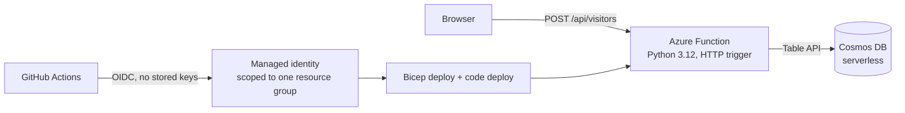

# Cloud Resume Challenge (Azure) — Backend

[](https://github.com/adye1/crc-backend/actions/workflows/backend.yml)
[](https://github.com/adye1/crc-backend/actions/workflows/codeql.yml)

Serverless visitor-counter API for my resume site ([frontend repo](https://github.com/adye1/crc-frontend)). Built for the [Cloud Resume Challenge](https://cloudresumechallenge.dev/), Azure edition, with a security-first pipeline.

**Live site:** https://adamdye.dev/ · **Write-up:** [What a security leader learned building the Cloud Resume Challenge on Azure](https://adamdye.substack.com/p/what-a-security-leader-learned-building)

## Architecture



`POST` adds one to the count and returns `{"count": N}`. `GET` only reads it. Updates use an ETag check and retry, so two simultaneous visitors cannot overwrite each other.

## Pipeline

Every push to `main` runs, in order:

1. **Test** — pytest unit tests and Bicep validation
2. **Supply-chain checks** — Syft SBOM, Grype scan (fails on High or above), pip-audit as a second source
3. **Deploy** — Bicep infrastructure, then the function code with its dependencies bundled
4. **Smoke test** — a Cypress suite calls the live API and checks that GET is read-only, POST raises the count by exactly one and persists it, and unsupported methods are rejected

CodeQL runs separately on pushes, pull requests, and monthly. Details and residual risks: [docs/supply-chain.md](docs/supply-chain.md).

## Repository layout

| Path | Purpose |
|---|---|
| `api/function_app.py` | HTTP trigger |
| `api/counter.py` | Counter logic, kept free of Azure bindings so it is easy to test |
| `api/tests/` | Unit tests using an in-memory fake table |
| `infra/main.bicep` | Cosmos DB (Table API, serverless), Function App, storage, plan |
| `.github/workflows/` | CI/CD and CodeQL |

## Run locally

```powershell
cd api
py -3.12 -m venv .venv
.\.venv\Scripts\Activate.ps1
pip install -r requirements.txt pytest
python -m pytest -q
```

To run the function you also need `local.settings.json` with a `COSMOS_TABLE_CONNECTION` value. That file is git-ignored and must never be committed.

## Decisions and trade-offs

- **Bicep over raw ARM JSON** for readability.
- **OIDC with a user-assigned managed identity** instead of stored credentials. My school tenant blocks app registrations, and a managed identity with a GitHub federated credential needs only Azure permissions.
- **Serverless everywhere** so the project costs close to nothing at rest.
- **Signed commits are required on `main`** by a repository ruleset.

## Known gaps

- The Cosmos key sits in a Function App setting. A managed identity with data-plane RBAC would remove it.
- Linux Consumption reaches end of life in September 2028. Moving to Flex Consumption is planned.
- Cosmos DB's Table API does not support Entra ID data-plane authentication, so the account key is injected into an app setting at deploy time. A Key Vault reference would improve this but needs extra pipeline permissions.

## Monitoring

Request telemetry goes to Application Insights and Log Analytics (capped at 0.1 GB/day). Metric alerts for server errors, request surges, and slow responses notify an email action group; the address comes from a GitHub secret, not the repository. Scale-out is capped at two instances.
