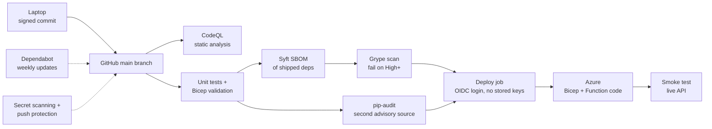

# Software supply-chain controls

How code gets from my laptop to production, and where each control sits.

## Controls in place

| Threat | Control |
|---|---|
| Stolen cloud credentials | No Azure secrets in GitHub. Workflows log in with OIDC to a managed identity scoped to one resource group |
| Vulnerable dependency | Syft SBOM, Grype (fails the build on High or above), pip-audit as an independent second source |
| Dependency decay in unchanged code | CodeQL runs monthly on a schedule; Dependabot opens weekly update PRs |
| Insecure code or workflow | CodeQL scans Python/JavaScript and the GitHub Actions workflows themselves |
| Leaked secret committed | GitHub secret scanning with push protection; `.gitignore` excludes `local.settings.json` and key files |
| Forged commit authorship | Signed commits (see below) |
| Moved or hijacked action tag | Every action pinned to a commit SHA |
| Overprivileged pipeline | Each pipeline identity is Contributor on its own resource group only |

## Residual risk and next steps

- Third-party actions are pinned to commit SHAs with the tag in a comment, and Dependabot proposes SHA updates. A compromised upstream release still needs a human to approve the bump.
- Requirements are not pinned to exact versions or hashes, so a build can pick up a newer release than the one tested. A lock file with hashes would close that.
- Solo repo: there is no second reviewer. With collaborators, require pull-request review and signed commits through a branch ruleset.
- The Function App stores its Cosmos key in an app setting. A managed identity with data-plane RBAC would remove the stored key.
